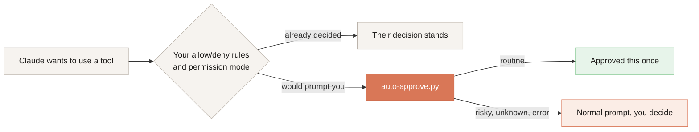

<p align="center">
  
</p>

<p align="center">
  <a href="https://github.com/F-WORKS-FBY/claude-code-auto-approve/actions/workflows/test.yml"></a>
  
  
  
  <a href="LICENSE"></a>
</p>

<p align="center"><a href="README.md">中文</a> · English</p>

---

Claude Code asks before it runs a command or edits a file. Nine times out of ten you click "Yes", but if you step away, the task sits there waiting for that click.

This project is a Claude Code hook that clicks those nine for you. Running tests, editing code and searching files go through. Deleting big directories, force-pushing, `sudo`, and the plan approval at the end of plan mode still stop and wait for you.

Everything is decided locally by rules in one Python file. There are no extra model calls. It runs on Linux, macOS and Windows and needs Python 3.8 or newer.

## What goes through, what waits for you

| Approved | Still prompts you |
|---|---|
| Commands (Bash, PowerShell) | Plan approval in plan mode |
| File edits and writes | Multiple-choice questions from Claude |
| Reading files, searching code | Commands on the deny list, such as `git push -f`, `sudo`, `DROP TABLE` |
| Web fetch and web search | Dangerous deletes, such as `rm -rf ~` or `rm -rf /var/www` |
| MCP tools, Skill, Workflow | Commands that ask to run outside the sandbox, and any tool not listed on the left |
| Looking around with sudo, such as `sudo docker ps` or `sudo ufw status` | On Windows, anything that touches drive C: except reading |

Each approval covers that one call only, like clicking "1 Yes". It never picks "don't ask again" for you. The full rules are under [Rule details](#rule-details).

## Install

Install it **on the machine where Claude Code runs**. If you use VS Code Remote-SSH, that is the server.

```bash
git clone https://github.com/F-WORKS-FBY/claude-code-auto-approve.git
cd claude-code-auto-approve
python3 install.py        # on Windows: python install.py
```

The installer runs the tests and copies the hook to `~/.claude/hooks/`. It then registers the hook in `~/.claude/settings.json`, leaving your other settings alone and backing the file up whenever it changes something. Finally it runs the registered command once to make sure Claude Code can start it. Running it again is safe; it won't register the hook twice. On Windows (WSL included) it also registers a pre-execution check that guards drive C:; see [Rule details](#rule-details).

> [!TIP]
> A first install (when there is no mode file yet) starts in **dry run**: it logs decisions but approves nothing. Trigger any permission prompt in Claude Code, click it as usual, and look in `~/.claude/hooks/auto-approve.log`. A line with a session directory and `[试运行] 会自动确认` ("dry run: would approve") means it works. Then switch it on:
>
> ```bash
> python3 install.py --mode on
> ```

<details>
<summary><b>Windows: <code>python</code> doesn't work or opens the Microsoft Store</b></summary>

<br>

Python isn't installed yet. Get it from [python.org](https://www.python.org/downloads/) and tick *Add python.exe to PATH*, or run `winget install Python.Python.3.12`.

If only `py` works, run `py -3 install.py`. Without git, use *Code → Download ZIP* on the repo page, unzip it, and run the same command inside the folder.

</details>

## Day to day

The switch is one word in `~/.claude/auto-approve.mode`. Changes take effect right away; you don't need to restart Claude Code.

| Value | Effect |
|---|---|
| `on` | On. A missing file also counts as on |
| `dryrun` | Log only, approve nothing |
| `off` | Paused. Anything unrecognised also counts as off |

You can edit the file directly or run `python3 install.py --mode off`. On an existing install, `--mode` only changes the switch; it doesn't reinstall.

Every decision is written to `~/.claude/hooks/auto-approve.log`. The log messages are in Chinese:

```
[10-16 16:17:32] 已自动确认（Bash命令）〔~/project · 5f2a9c1e〕Bash：npm test
[10-16 16:21:55] 跳过（命中黑名单「docker volume prune」）〔~/project · 8d41b07a〕Bash：docker volume prune -f
[10-16 16:44:10] 跳过（危险删除「rm ~/projects」）〔~/project · 5f2a9c1e〕Bash：rm -rf ~/projects
```

`已自动确认` means approved. `跳过（…）` means it was left to you, with the reason in the brackets.

## How it works

Claude Code has an official [`PermissionRequest` hook](https://code.claude.com/docs/en/hooks). Whenever it is about to ask for permission, it hands the tool name and arguments to your script. If the script says allow, the step runs without your click (in the VS Code extension the prompt may flash briefly). If the script says nothing, the prompt waits for you as usual.



So the hook only handles requests that were going to prompt you anyway, and your own allow and deny rules always apply first. Rules in `permissions.ask` are the exception: all they do is make Claude Code ask, and that question goes to this hook. For anything you always want to confirm yourself, use a deny rule or add it to the hook's deny list.

If the script crashes, times out or can't find Python, that counts as saying nothing, and you get the normal prompt. The one exception is a deleted hook script: then Claude Code refuses every action that needs permission. Uninstall with `install.py --uninstall` instead of deleting files.

## How is this different from auto mode?

Claude Code has a built-in auto mode with the same goal. For each action that needs permission, it sends an extra request to a classifier model (Sonnet 5 by default) to judge whether the action is safe.

Compared with auto mode, this hook differs in three ways:

1. **When the classifier request fails, the task stalls anyway.** The classifier request is a separate, non-streaming call that goes to the API address you configured. If it is rate-limited, times out or is rejected by a gateway, Claude Code can't judge the action. It reports `<model> is temporarily unavailable (rate-limited), so auto mode cannot determine the safety of Bash` and refuses to run the step. It does not fall back to asking you. The model in that message is the **classifier's** model, not the one you are chatting with, so it looks like your main model is rate-limited while chat works fine.
2. **It isn't available everywhere.** Some plans don't include it, it is off while fast mode is on, and some models don't support it.
3. **The rules live inside a model.** You can't read or change them. This hook's rules fit on one page of regexes, and plan approval always stays with a person.

If auto mode is reliable for you, it is more flexible than regexes. If you go through a third-party relay, want to skip the extra model call, or want fixed rules you can edit, use this hook.

Use the hook with the default or acceptEdits mode. While auto mode is on, auto mode decides on commands itself and Claude Code ignores the hook's approval of them.

> [!NOTE]
> If you use Claude through a gateway or relay and have set `CLAUDE_CODE_ATTRIBUTION_HEADER=0`, classifier requests lose the marker that identifies them as Claude Code traffic and are more likely to be rejected. The [official docs](https://code.claude.com/docs/en/llm-gateway-protocol) describe this, and the fix in 2.1.229 only covers direct connections to the Anthropic API. If you want to keep using auto mode, try removing that setting first.

## Rule details

**What gets checked.** Only the command a Bash or PowerShell call will run, and the arguments of MCP tools (an SQL string, for example). Claude's description of the command, file paths and search terms are not checked, so reading a file called `shutdown.ts` doesn't prompt. Segments that only search text (`grep`, `rg`, `git grep`, `git log`) are skipped. Workflow scripts are not checked either, because every step a subagent runs goes through the hook on its own.

Code fed to Python, Node, Ruby, Perl or PHP is treated as data too: heredocs like `python3 - <<'EOF'`, one-liners like `python3 -c '…'`, and PowerShell `@'…'@ | python -`. Words like `sudo` or `rm -rf` inside that code don't prompt. But if the code runs commands, for example through `subprocess`, `os.system`, `child_process`, `system()` or backticks, the whole thing is checked as usual. An unquoted `<<EOF` that contains `$(…)` is checked too, because the shell runs that part first.

**Deny list.** If any of these appear in the command, the call is not approved (case-insensitive):

- `git push` that rewrites or deletes remote history: `-f` (including combinations like `-uf`), `--force`, `--force-with-lease`, `--delete`, `-d`, `--mirror`, `+branch`, `:branch`. A plain push is approved.
- `git reset --hard`, `git clean`, `git stash drop`, `git stash clear`. `git clean -n` only previews and is approved.
- The git rules still match when global options sit in between, as in `git -C /some/repo push --force`.
- Privilege elevation: `sudo`, `doas`, `gsudo` (Windows), `pkexec`, and `Start-Process … -Verb RunAs` (run as administrator on Windows). When `sudo`, `doas` or `gsudo` is followed by a read-only command, it is approved; see "Read-only commands" below.
- `mkfs`, `fdisk`, `parted`, `shutdown`, `reboot`, `poweroff`, `halt`, `chmod 777` (also `0777`, `-R`, `-Rv`)
- `dd` that writes somewhere (`of=` a disk or an image file). A `dd` that only reads, or writes to `/dev/null`, is approved.
- `DROP` or `TRUNCATE` of a `TABLE` / `DATABASE` / `SCHEMA`
- `kubectl delete` (also with `-n` or `--context` first), `docker rm` / `rmi`, `docker container|image|volume|network|system rm|prune`, `docker compose down -v`
- `npm` / `pnpm` / `yarn publish`. With `--dry-run` they are approved, and so is `kubectl delete --dry-run`.
- Windows: `Format-Volume`, `Clear-Disk`, `Stop-Computer`, `Restart-Computer`

**Read-only commands.** Commands that only look. `sudo` followed by one of these is approved, and on Windows they are the only commands approved when drive C: is involved.

- Files, folders, disks: `ls`, `cat`, `head`, `tail`, `grep`, `find` (without `-delete` or `-exec`), `du`, `df`, `stat`, and so on
- Processes, ports, firewalls: `ps`, `ss`, `netstat`, `lsof`, `ufw status`, `iptables -L` / `-S`, `nft list`, `firewall-cmd --list-*`, and `pfctl -s` on macOS
- Services and logs: `systemctl status`, `journalctl` (except the cleanup options), `dmesg` (without `-c`), and `launchctl list` and `log show` on macOS
- Containers: `ps`, `images`, `logs`, `inspect`, `info`, `volume ls`, `compose ps` and similar for `docker` / `podman` / `nerdctl`, plus `crictl ps`. Nothing depends on Docker, so machines without it work the same
- Queries such as `git status`, `git log`, `git diff`, `git show`, `npm ls` and `pip list`
- PowerShell `Get-*`, `Test-*`, `Select-String`, `Select-Object` and similar

Options such as `-u user` and `-n` are understood. Anything that changes something is still stopped, for example `sudo docker rm`, `sudo systemctl restart`, `sudo journalctl --vacuum-time=1d` or `sudo iptables -F`.

After sudo the command runs as root, so the forms of these commands that write a file, run another program or change system state are stopped too: `tree -o`, `file -C`, `git log --output`, `git -c key=value` (settings such as `core.fsmonitor` run programs), `git grep -O`, `rg --pre`, `ag --pager`, `date -s`, `hostname newname`, `dmesg -n`, `ss -K`, and `docker config create` (`config` only counts after `compose`). The full list is `SUDO_READ_ONLY` in `auto-approve.py`.

When checking drive C: on Windows, these also count as read-only:

- Text tools: `sort`, `uniq`, `cut`, `tr`, `sed`, `awk`, `jq`, `yq`, `diff` and similar. They are not approved after sudo. Forms that write a file or run a command don't count: `sort -o`, `sort --compress-program`, `sed -i`, `sed -f`, `yq -i`, `yq -s`, awk's `-i inplace`, `-f`, `system()` and `>`, and a second file argument to `uniq`. A `sed` script is also read with sed's own syntax: the `w`, `W` and `e` commands and `s///w` / `s///e` don't count as read-only, while the letters inside a substitution like `s/hello/world/` don't matter
- `xxx --version` and `xxx --help` for a bare command name. With a path it could be any program, so it doesn't count

**Drive C: on Windows.** On Windows (including `/mnt/c` under WSL), if the current folder is on C:, or a command, file path or MCP argument touches C:, everything except reading needs your confirmation.

- Reading files and searching are approved. A Bash or PowerShell command is approved only if every part of it is a read-only command and nothing is written to a file with `>`.
- These spellings are recognised: `C:\…`, `C:/…`, Git Bash `/c/…`, WSL `/mnt/c/…`, and `~`, `$HOME`, `$env:USERPROFILE`, `%TEMP%` and other environment variables that point to C:. Git Bash's `/tmp` is `%TEMP%`, so it counts as C: too. PowerShell's `$_` is the pipeline variable, not an environment variable.
- Commands that write into your user profile on C: without naming a path count as touching C:: `pip install`, `npm -g`, `git config --global` (except `--get`), `setx`, `reg add`, `winget install`, `claude mcp add` and so on. The full list is `USER_PROFILE_WRITERS`.
- Wrapped commands are judged by the command inside, up to two levels deep: `bash -c '…'`, `powershell -Command "…"`, `cmd /c …`. `powershell -File`, `-EncodedCommand` and `bash script.sh` hide what they run, so they don't count as read-only.
- PowerShell is read with its own syntax: text in strings and comments doesn't count; every `Verb-Noun` command anywhere, including inside braces, has to be a reading one such as Get, Test, Select, Where, Sort, Format or Measure, so a delete hidden in `Select-Object @{e={Remove-Item $_}}` is caught; `[IO.File]::WriteAllText`, `.Delete()`, `.InvokeMember()`, assigning to an object's property, `&` calls, `iex` and `"$(…)"` don't count as read-only.
- Besides answering prompts, the hook registers a pre-execution check (PreToolUse). So even in acceptEdits mode, where Claude Code would edit project files without asking, edits on C: will prompt you.
- To turn this off, change `PROTECTED_DRIVES = {"C"}` in `auto-approve.py` to `set()` and run `install.py` again. Add drive letters to protect more drives.
- Only the command text is checked, so writes a program makes on its own can't be seen: `npm install` filling the npm cache on C:, `python install.py` writing to `~/.claude`, a script writing to `%TEMP%`.

**Deletes.** `rm` is not blocked outright. The hook works out each target and only stops the ones you can't undo:

- `/`, a home directory, and anything directly inside it. `~/projects`, `/home/me/projects`, `/Users/me/Documents` and `C:\Users\me\Desktop` all count
- `.`, `..`, `*`, `./*`
- Absolute paths two levels deep or less, such as `/var/www`. On Windows the count starts at the drive; the Git Bash form `/c/Users/me` is understood too
- `/tmp` itself, or `/tmp/*` (macOS `/private/tmp` included)
- `X/*` is treated like `X`, so `~/projects/*` is stopped too
- Targets that become one of the above when a variable is empty, such as `$DIR/` or `"$DIR"/*`. If the variable is set earlier in the command (`D=/x/y; rm -rf $D`), the real path is checked instead. Forms like `${HOME:?}` and `${X:-default}` are expanded
- Targets that come from command output: `$(...)` or backticks
- Deletes wrapped in another command are checked too: `bash -c '…'`, `ssh host "…"`, `docker exec … sh -c '…'`, `/bin/rm`, `\rm`
- PowerShell `Remove-Item` (and `ri`, `rd`, `rmdir`, `del`, `erase`) follows the same target rules; `$env:USERPROFILE` and `$env:TEMP` are expanded
- Targets that come from an earlier command's output: `… | xargs rm`

Every other delete is approved, for example `rm -rf ./build`, `rm -rf /home/me/project/dist` or `Remove-Item -Recurse .\node_modules`. `git rm --cached` only stops git from tracking a file and is approved as well. `find … -delete` and `find … -exec rm` are not checked.

**Changing the rules.** Edit `auto-approve.py` in the repo (not the installed copy in `~/.claude/hooks/`); the rules are in the config section at the top. Update the matching cases in `tests/test_hook.py`, then run `python3 install.py` again; it runs the tests before installing. If you add a tool to the allow list, add it to `MATCHER` in `install.py` as well. Otherwise Claude Code never sends that tool's requests to the hook.

## Uninstall

```bash
python3 install.py --uninstall
```

This removes only this hook from `settings.json` and deletes the hook script. The mode file and the log stay. Don't delete just the script and leave the entry in `settings.json`: Claude Code would then refuse every action that needs permission.

## Things to know

> [!WARNING]
> This is not a sandbox. The rules are regexes plus simple command parsing. They catch an accidental "Yes", not someone working around them on purpose, for example by writing the command into a script first. Use a container or VM if you need real isolation.

- In plan mode, only the plan approval itself is left to you. Claude Code holds back edits and commands in plan mode by prompting, and the hook approves those prompts by its usual rules, so Claude may edit files or run commands before you approve the plan.
- Quoted text inside a command is checked as a command too, because it may be what `bash -c '…'` runs. So `echo "rm -rf ~"`, or a commit message that mentions `git push -f`, will prompt you. It errs towards asking. Code fed to an interpreter that doesn't run commands is the exception; see [Rule details](#rule-details).
- File edits and writes are approved whatever the path, including `~/.claude/settings.json`, `~/.bashrc`, files under `.git/`, and this hook's own mode file. Claude Code's built-in confirmation for these sensitive files is approved too. If that matters to you, block those files with `permissions.deny` in `settings.json`.
- MCP tools are always approved unless an argument hits the deny list, including tools that send messages or delete remote resources. If that worries you, replace `mcp__.*` in `MATCHER` in `install.py` with the MCP servers you trust.
- On Windows, if your projects live on C:, the drive C: rule means every step except reading will ask you. To get fewer prompts in day-to-day work, keep projects on another drive.
- If several people share one OS account, one install covers everyone's sessions.

<details>
<summary><b>Installed, but nothing shows up in the log</b></summary>

<br>

Feed the hook one input by hand. The commands below bypass the mode file and the log for this one call, so they should print JSON containing `"allow"` even in dry run, and they write nothing to the log:

```bash
echo '{"tool_name":"Bash","tool_input":{"command":"ls"}}' | AUTO_APPROVE_MODE_FILE=/nonexistent AUTO_APPROVE_LOG=/dev/null python3 ~/.claude/hooks/auto-approve.py
```

```powershell
$env:AUTO_APPROVE_MODE_FILE = "$env:TEMP\nonexistent"; $env:AUTO_APPROVE_LOG = "NUL"
'{"tool_name":"Bash","tool_input":{"command":"ls"}}' | python "$HOME\.claude\hooks\auto-approve.py"
Remove-Item Env:AUTO_APPROVE_MODE_FILE, Env:AUTO_APPROVE_LOG
```

If that works but your sessions still don't log anything, check `claude --version` (it was verified on 2.1.301) and look for the entry under `hooks.PermissionRequest` in `~/.claude/settings.json`.

On Windows, if it works by hand but not inside Claude Code, Claude Code probably can't find `python`. Reinstall with an explicit command, for example `python install.py --python "py -3"`.

</details>

<details>
<summary><b>My config directory isn't <code>~/.claude</code></b></summary>

<br>

If `CLAUDE_CONFIG_DIR` is set, both the installer and the hook use it. You can also pass `--config-dir` to the installer.

</details>

## Development

```bash
python3 tests/test_hook.py       # hook rules
python3 tests/test_install.py    # installer
```

On every push, GitHub Actions runs both suites on Ubuntu, macOS and Windows with the latest Python 3, plus Python 3.8 on Ubuntu and Windows. Every system also does a real install and calls the installed hook from a shell; Windows additionally calls it from Windows PowerShell 5.1.

## Background

This started as a Windows PowerShell script. It read the Claude Code panel in VS Code through the accessibility API, found permission prompts and clicked "1 Yes". Claude Code turned out to offer a hook for exactly this, so the same rules moved into it. Now there's no screen reading or tab switching, and every session is covered.

## License

[MIT](LICENSE)
