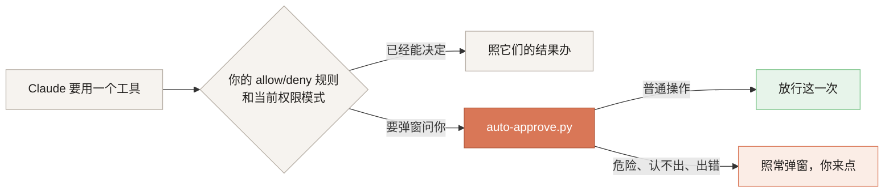

<p align="center">
  
</p>

<p align="center">
  <a href="https://github.com/F-WORKS-FBY/claude-code-auto-approve/actions/workflows/test.yml"></a>
  
  
  
  <a href="LICENSE"></a>
</p>

<p align="center">中文 · <a href="README.en.md">English</a></p>

---

Claude Code 每次要跑命令、改文件，都会弹窗问你一句"可以吗"。十次里有九次你都会点「Yes」，可只要你一走开，任务就停在弹窗上干等。

这个项目是一个 Claude Code 钩子，替你点掉那九次：跑测试、改代码、搜文件这类操作直接放行；删大目录、强推、`sudo` 这类操作，还有 plan 模式最后的方案确认，照旧弹窗，等你自己点。

判断全在本地完成，规则写在一个 Python 文件里，不额外调用模型。Linux、macOS、Windows 都能用，只需要 Python 3.8 以上。

## 放行什么，留给你什么

| 直接放行 | 照旧弹窗，等你点 |
|---|---|
| 跑命令（Bash、PowerShell） | plan 模式的方案确认 |
| 改文件、写文件 | Claude 问你的选择题 |
| 读文件、搜代码 | 命中黑名单的命令，比如 `git push -f`、`sudo`、`DROP TABLE` |
| 查网页、联网搜索 | 危险的删除，比如 `rm -rf ~`、`rm -rf /var/www` |
| MCP 工具、Skill、Workflow | 要求在沙箱外运行的命令，以及左边没列出的工具 |
| 借 sudo 查看系统，比如 `sudo docker ps`、`sudo ufw status` | Windows 上涉及 C 盘的操作（只读除外） |

放行只对这一次有效，相当于你点了「1 Yes」，不会替你勾"以后都别问"。完整的黑名单和删除规则见[规则细节](#规则细节)。

## 安装

钩子要装在**运行 Claude Code 的那台机器**上。如果你用 VSCode 的 Remote-SSH 连服务器，就装在服务器上。

```bash
git clone https://github.com/F-WORKS-FBY/claude-code-auto-approve.git
cd claude-code-auto-approve
python3 install.py        # Windows 上是 python install.py
```

安装脚本会先跑一遍测试，再把钩子拷到 `~/.claude/hooks/`，然后登记到 `~/.claude/settings.json`。原有的配置不会被改动，有改动时会先备份一份。最后它会把登记好的命令实际跑一遍，确认 Claude Code 能调起来。重复运行也没关系，不会重复登记。在 Windows 上（包括 WSL），它还会多登记一个执行前检查，用来守住 C 盘，见[规则细节](#规则细节)。

> [!TIP]
> 第一次安装（还没有开关文件时）是**试运行**：只记日志，不放行。在 Claude Code 里随便触发一次授权弹窗，照常点掉，再看 `~/.claude/hooks/auto-approve.log`。里面出现带会话目录的 `[试运行] 会自动确认` 就说明装好了，然后正式开启：
>
> ```bash
> python3 install.py --mode on
> ```

<details>
<summary><b>Windows：<code>python</code> 打不开，或者打开的是应用商店</b></summary>

<br>

这说明还没装 Python。到 [python.org](https://www.python.org/downloads/) 下载安装，安装时勾上 *Add python.exe to PATH*；也可以运行 `winget install Python.Python.3.12`。

如果只有 `py` 能用，就运行 `py -3 install.py`。没装 git 的话，在仓库页面点 *Code → Download ZIP*，解压后进入目录执行同样的命令。

</details>

## 平时怎么用

开关是 `~/.claude/auto-approve.mode` 文件里的一个词，改完立刻生效，不用重启 Claude Code：

| 写什么 | 效果 |
|---|---|
| `on` | 开启。这个文件不存在时也按开启处理 |
| `dryrun` | 只记日志，不放行，适合先观察一段时间 |
| `off` | 暂停。写了认不出的内容，也按暂停处理 |

可以直接编辑这个文件，也可以运行 `python3 install.py --mode off`。已经装好时，`--mode` 只改开关，不会重新安装。

每次判断都会记一行日志，在 `~/.claude/hooks/auto-approve.log`：

```
[10-16 16:17:32] 已自动确认（Bash命令）〔~/project · 5f2a9c1e〕Bash：npm test
[10-16 16:21:55] 跳过（命中黑名单「docker volume prune」）〔~/project · 8d41b07a〕Bash：docker volume prune -f
[10-16 16:44:10] 跳过（危险删除「rm ~/projects」）〔~/project · 5f2a9c1e〕Bash：rm -rf ~/projects
```

某个弹窗没被自动放行，想知道为什么，翻这个日志就能看到原因。

## 它是怎么工作的

Claude Code 有一个官方的 [`PermissionRequest` 钩子](https://code.claude.com/docs/en/hooks)：每次要弹授权窗时，它会把工具名和参数交给你指定的脚本。脚本说放行，这一步直接执行，不用你点（VSCode 插件里弹窗可能会一闪而过）；脚本不吭声，弹窗照常等你。



也就是说，这个钩子只接手"本来就要弹窗"的请求，你自己配的 allow / deny 规则照常优先生效。`permissions.ask` 里的规则除外：它们的作用只是让 Claude Code 弹窗，而弹窗正好会交给这个钩子。想始终自己确认的操作，请写成 deny 规则，或者加进钩子的黑名单。

脚本报错、超时、找不到 Python，都算"不吭声"，结果是照常弹窗。只有一种情况例外：钩子脚本文件被删掉了，Claude Code 会把需要确认的操作直接拒绝。所以卸载请用 `install.py --uninstall`，不要直接删文件。

## 和 auto 模式有什么不同

Claude Code 自带一个 auto 模式，也是为了少打扰你。它的做法是：每个需要授权的操作，先额外发一个请求给分类模型（默认是 Sonnet 5），让它判断安不安全。

和 auto 模式相比，这个钩子有三点不同：

1. **分类请求一失败，任务照样会卡住。** 分类请求是单独发出的非流式请求，走的也是你配置的 API 地址。它一旦被限流、超时或者被网关拒掉，Claude Code 就判断不了这一步安不安全，会报 `<模型> is temporarily unavailable (rate-limited), so auto mode cannot determine the safety of Bash`，然后直接拒绝执行，不会退回到弹窗让你确认。报错里写的是**分类模型**的名字，不是你正在用的模型，所以看起来像主模型被限流了，其实聊天一切正常。
2. **它有使用条件。** 不是每个套餐都能开，fast 模式下不能用，有些模型也不支持。
3. **判断标准在模型里，看不见也改不了。** 这个钩子的规则就是一页正则，拦什么、放什么一目了然，计划确认永远留给人。

如果 auto 模式在你那里一直很稳，它的判断会比正则更灵活。如果你走第三方中转、想省掉这一次额外的模型调用，或者想要一套确定、能自己改的规则，就用这个钩子。

这个钩子配合默认模式或 acceptEdits 模式使用。开着 auto 模式时，命令由 auto 模式自己判断，Claude Code 不采纳钩子对命令的放行。

> [!NOTE]
> 如果你经网关或中转使用 Claude，又设置了 `CLAUDE_CODE_ATTRIBUTION_HEADER=0`，分类请求会缺少一段用来识别"这是 Claude Code 请求"的标记，更容易被拒。[官方文档](https://code.claude.com/docs/en/llm-gateway-protocol)说明了这一点，2.1.229 版的修复只覆盖直连官方 API 的情况。想继续用 auto 模式的话，可以先试着去掉这个设置。

## 规则细节

**查哪些内容**：只查 Bash / PowerShell 要执行的命令本身，以及 MCP 工具的参数（比如数据库工具里的 SQL）。Claude 给命令写的说明、文件路径、搜索关键词都不查，所以读一个叫 `shutdown.ts` 的文件不会弹窗。`grep`、`rg`、`git grep`、`git log` 这类只是在找文字的命令，整段跳过。Workflow 的脚本也不查，因为子代理执行的每一步还会各自经过钩子。

**黑名单**：命令里出现以下任意一条，就不放行（不区分大小写）。

- 会改写或删除远程历史的 `git push`：`-f`（包括 `-uf` 这类组合）、`--force`、`--force-with-lease`、`--delete`、`-d`、`--mirror`、`+分支`、`:分支`。普通的 push 放行。
- `git reset --hard`、`git clean`、`git stash drop`、`git stash clear`。`git clean -n` 只是预览，放行。
- 上面这些 git 规则，中间夹了 `git -C /某个仓库` 这类参数也照样认得出。
- 提权：`sudo`、`doas`、`gsudo`（Windows）、`pkexec`，以及 `Start-Process … -Verb RunAs`（Windows 以管理员身份运行）。`sudo`、`doas`、`gsudo` 后面跟的如果只是查看，就放行，见下面的"只读命令"。
- `mkfs`、`fdisk`、`parted`、`shutdown`、`reboot`、`poweroff`、`halt`、`chmod 777`（`0777`、`-R`、`-Rv` 都算）
- `dd` 往外写（`of=` 写盘或写镜像文件）。只读取的 `dd`、写到 `/dev/null` 的 `dd` 放行。
- `DROP` 或 `TRUNCATE` 的 `TABLE` / `DATABASE` / `SCHEMA`
- `kubectl delete`（前面带 `-n`、`--context` 也算）、`docker rm` / `rmi`、`docker container|image|volume|network|system rm|prune`、`docker compose down -v`
- `npm` / `pnpm` / `yarn publish`。带 `--dry-run` 的放行，`kubectl delete --dry-run` 同样放行。
- Windows：`Format-Volume`、`Clear-Disk`、`Stop-Computer`、`Restart-Computer`

**只读命令**：只看不改的命令。`sudo` 后面跟的是这些就放行；Windows 上涉及 C 盘时，也只放行这些。

- 看文件、目录、磁盘：`ls`、`cat`、`head`、`tail`、`grep`、`find`（不带 `-delete`、`-exec`）、`du`、`df`、`stat` 等
- 看进程、端口、防火墙：`ps`、`ss`、`netstat`、`lsof`、`ufw status`、`iptables -L` / `-S`、`nft list`、`firewall-cmd --list-*`，macOS 的 `pfctl -s`
- 看服务和日志：`systemctl status`、`journalctl`（清理日志的参数除外）、`dmesg`（不带 `-c`），macOS 的 `launchctl list`、`log show`
- 看容器：`docker` / `podman` / `nerdctl` 的 `ps`、`images`、`logs`、`inspect`、`info`、`volume ls`、`compose ps` 等，以及 `crictl ps`。不依赖 docker，没装 docker 的机器照样适用
- `git status`、`git log`、`git diff`、`git show` 这类查询，`npm ls`、`pip list` 这类查询，`xxx --version`
- PowerShell 的 `Get-*`、`Test-*`、`Select-String`、`Select-Object` 这类命令

带 `-u 用户`、`-n` 这些参数也认得。会改东西的照样拦，比如 `sudo docker rm`、`sudo systemctl restart`、`sudo journalctl --vacuum-time=1d`、`sudo iptables -F`。完整清单在 `auto-approve.py` 的 `READ_ONLY_COMMANDS`。

**Windows 的 C 盘**：在 Windows 上（包括 WSL 里的 `/mnt/c`），只要当前目录在 C 盘，或者命令、文件路径、MCP 参数里涉及 C 盘，除了读，一律要你确认。

- 读文件、搜索放行；Bash / PowerShell 命令每一段都是只读命令，而且没有用 `>` 往文件里写，才放行。
- 认得这些写法：`C:\…`、`C:/…`、Git Bash 的 `/c/…`、WSL 的 `/mnt/c/…`，以及指向 C 盘的 `~`、`$HOME`、`$env:USERPROFILE`、`%TEMP%` 这类环境变量。
- 钩子除了接手弹窗，还会登记一个执行前检查（PreToolUse）。所以开着 acceptEdits 模式时，Claude Code 本来不问就会改的项目文件，只要在 C 盘，也会弹窗问你。
- 不想要这条规则，把 `auto-approve.py` 里的 `PROTECTED_DRIVES = {"C"}` 改成 `set()`，再跑一次 `install.py`。想多保护几个盘，就往里面加盘符。

**删除**：`rm` 不会一律拦下。钩子会先解析出删除目标，只拦删了就无法挽回的那些。

- 根目录、家目录，以及家目录下一层。`~/projects`、`/home/me/projects`、`/Users/me/Documents`、`C:\Users\me\Desktop` 都算
- `.`、`..`、`*`、`./*`
- 两层以内的绝对路径，比如 `/var/www`。Windows 上从盘符往下数，Git Bash 写法的 `/c/Users/me` 也认得
- `/tmp` 本身，或者 `/tmp/*`（macOS 的 `/private/tmp` 也算）
- 删 `X/*` 和删 `X` 本身同样对待：`~/projects/*` 也会拦
- 变量为空时会变成上面这些路径的写法，比如 `$DIR/`、`"$DIR"/*`。如果命令里先给变量赋过值（`D=/x/y; rm -rf $D`），就代入实际路径再判断。`${HOME:?}`、`${X:-默认值}` 这类写法也会展开
- 删除目标是命令的输出，比如 `$(...)`、反引号
- 套在别的命令里的删除同样会检查：`bash -c '…'`、`ssh 服务器 "…"`、`docker exec … sh -c '…'`、`/bin/rm`、`\rm`
- PowerShell 的 `Remove-Item`（以及 `ri`、`rd`、`rmdir`、`del`、`erase`）按同样的规则看目标，`$env:USERPROFILE`、`$env:TEMP` 也会展开

- 删除目标来自前面命令的输出：`… | xargs rm`

其它删除都放行，比如 `rm -rf ./build`、`rm -rf /home/me/project/dist`、`Remove-Item -Recurse .\node_modules`。`git rm --cached` 只是让 git 不再跟踪文件，文件还在，也放行。`find … -delete` 和 `find … -exec rm` 不在检查范围内。

**改规则**：改仓库里的 `auto-approve.py`（不是 `~/.claude/hooks/` 里装好的那份），规则都在文件开头的配置区。`tests/test_hook.py` 里对应的用例也要一起改，然后再跑一次 `python3 install.py`，它会先跑测试再装上去。往白名单里加工具时，`install.py` 里的 `MATCHER` 也要一起加上，否则 Claude Code 根本不会把这个工具的请求交给钩子。

## 卸载

```bash
python3 install.py --uninstall
```

这条命令只会把这个钩子从 `settings.json` 里摘掉，并删除钩子脚本；开关文件和日志会留着。不要只删钩子脚本而留着 `settings.json` 里的登记，那样 Claude Code 会把需要确认的操作直接拒绝。

## 需要知道的事

> [!WARNING]
> 这个钩子不是沙箱。规则只是正则加上简单的命令解析，用来防止"顺手点了 Yes"这种失误，挡不住故意绕过，比如先把命令写进脚本再执行。真要隔离，请用容器或虚拟机。

- plan 模式下只有方案确认这一个弹窗留给你。Claude Code 在 plan 模式里是靠弹窗拦住改动和命令的，这些弹窗钩子会照常按规则放行，所以方案确认之前，Claude 也可能已经改了文件、跑了命令。
- 命令里引号括起来的文字也会被当成命令检查，因为它可能是 `bash -c '…'` 要执行的内容。所以 `echo "rm -rf ~"`、提交说明里写了 `git push -f` 这种，也会弹窗，宁可多问一次。
- 文件编辑和写入不看路径，一律放行，包括 `~/.claude/settings.json`、`~/.bashrc`、`.git/` 下的文件，以及这个钩子自己的开关文件。Claude Code 对这类敏感文件自带的确认弹窗，也会被放行。如果你在意，可以在 `settings.json` 的 `permissions.deny` 里禁止改这些文件。
- MCP 工具一律放行，只要参数没命中黑名单。这包括会发消息、删远程资源的工具。不放心的话，把 `install.py` 里 `MATCHER` 的 `mcp__.*` 换成你信得过的那几个 MCP 服务。
- Windows 上项目放在 C 盘的话，按上面的 C 盘规则，除了读，每一步都会问你。想让日常开发少弹窗，可以把项目放到别的盘。
- 几个人共用同一个系统账号时，装一次就对所有人的会话都生效。

<details>
<summary><b>装好了，日志里却一条记录都没有</b></summary>

<br>

先手动给钩子喂一条输入，看它自己能不能跑。下面的命令临时绕开开关文件和日志，不管现在是不是试运行，都应该输出一段带 `"allow"` 的 JSON，也不会往日志里写东西：

```bash
echo '{"tool_name":"Bash","tool_input":{"command":"ls"}}' | AUTO_APPROVE_MODE_FILE=/nonexistent AUTO_APPROVE_LOG=/dev/null python3 ~/.claude/hooks/auto-approve.py
```

```powershell
$env:AUTO_APPROVE_MODE_FILE = "$env:TEMP\nonexistent"; $env:AUTO_APPROVE_LOG = "NUL"
'{"tool_name":"Bash","tool_input":{"command":"ls"}}' | python "$HOME\.claude\hooks\auto-approve.py"
Remove-Item Env:AUTO_APPROVE_MODE_FILE, Env:AUTO_APPROVE_LOG
```

手动能跑，会话里却没有记录的话，先用 `claude --version` 看看版本，作者是在 2.1.301 上验证的。再检查 `~/.claude/settings.json` 的 `hooks.PermissionRequest` 里有没有这一项。

Windows 上手动能跑、在 Claude Code 里却不行，多半是 Claude Code 的进程找不到 `python`。重装时用 `--python` 指定一个能用的命令就行，比如 `python install.py --python "py -3"`。

</details>

<details>
<summary><b>配置目录不在 <code>~/.claude</code></b></summary>

<br>

设置了 `CLAUDE_CONFIG_DIR` 的话，安装脚本和钩子都会改用那个目录。也可以在安装时用 `--config-dir` 指定。

</details>

## 开发

```bash
python3 tests/test_hook.py       # 钩子的规则
python3 tests/test_install.py    # 安装脚本
```

每次推送，GitHub Actions 都会在 Ubuntu、macOS、Windows 上用最新的 Python 跑全部测试，另外在 Ubuntu 和 Windows 上用 Python 3.8 各跑一遍。每个系统上都会做一次真实安装，再从 shell 里调用一次装好的钩子；Windows 上还会从 Windows PowerShell 5.1 里调用一次。

## 来历

最早是一个 Windows 上的 PowerShell 脚本：它通过系统的无障碍接口读取 VSCode 里 Claude Code 面板的界面，认出授权弹窗后，自动去点「1 Yes」。后来发现 Claude Code 自己就提供了钩子，就把那套规则搬了过来。现在不用读界面、切标签，所有会话一次全管上。

## 许可证

[MIT](LICENSE)
